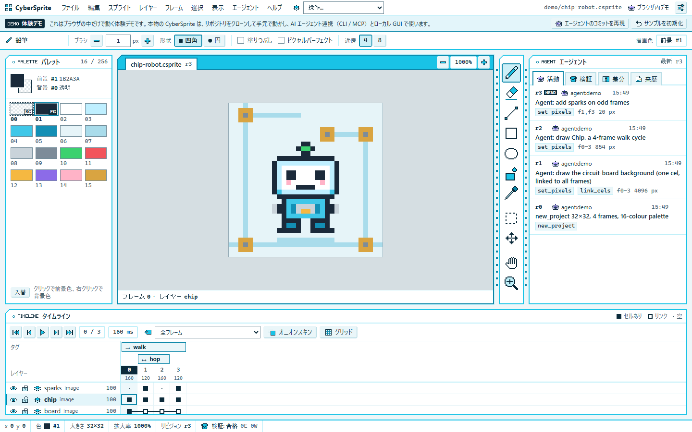
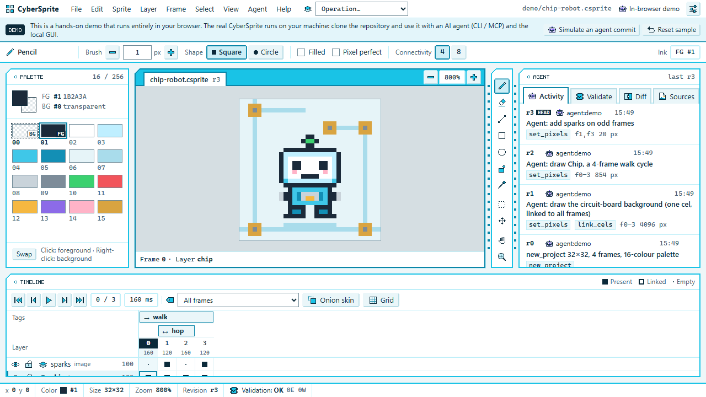
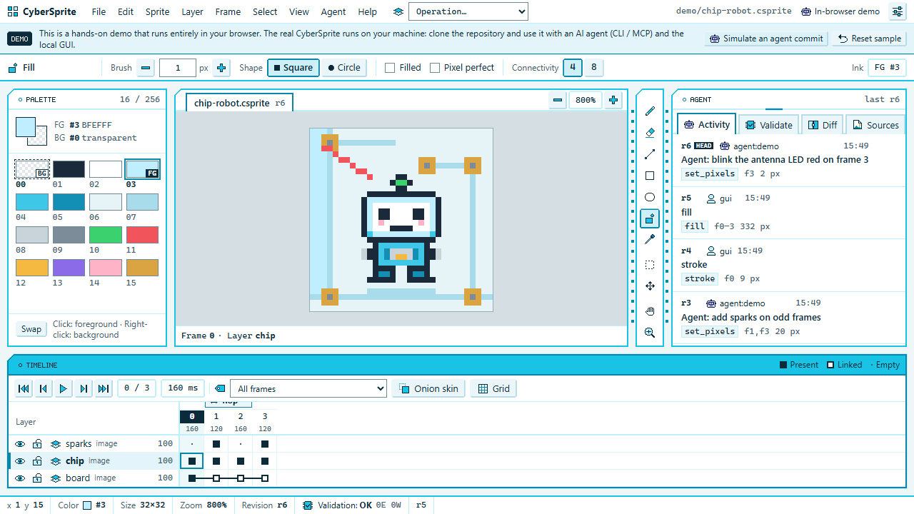
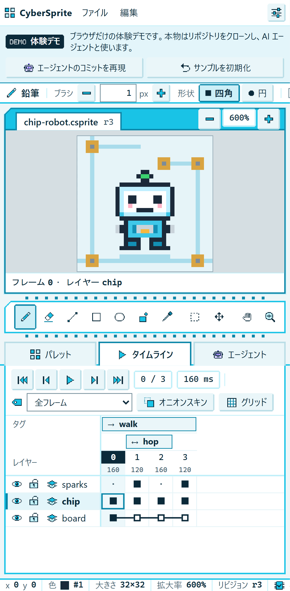
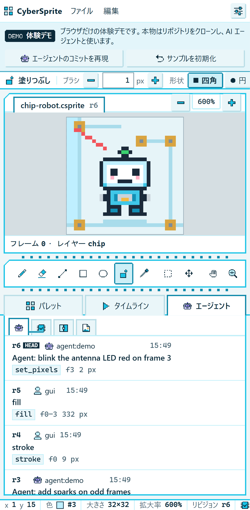
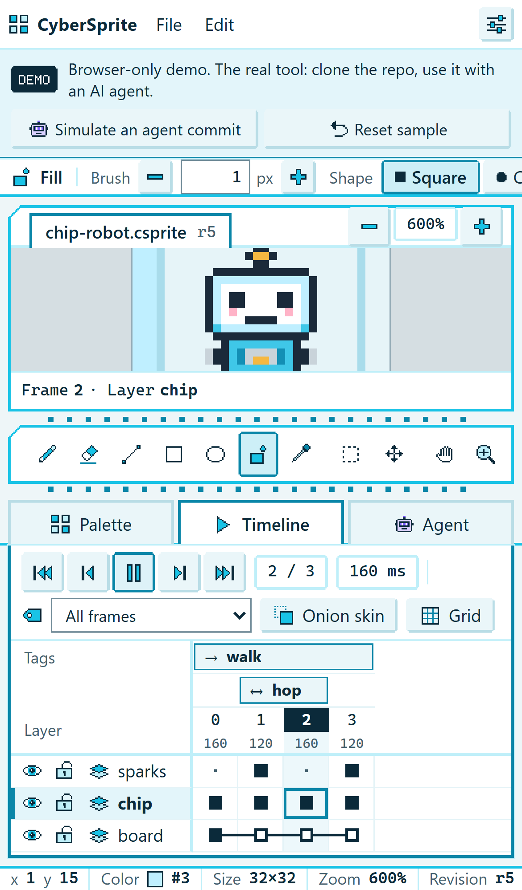
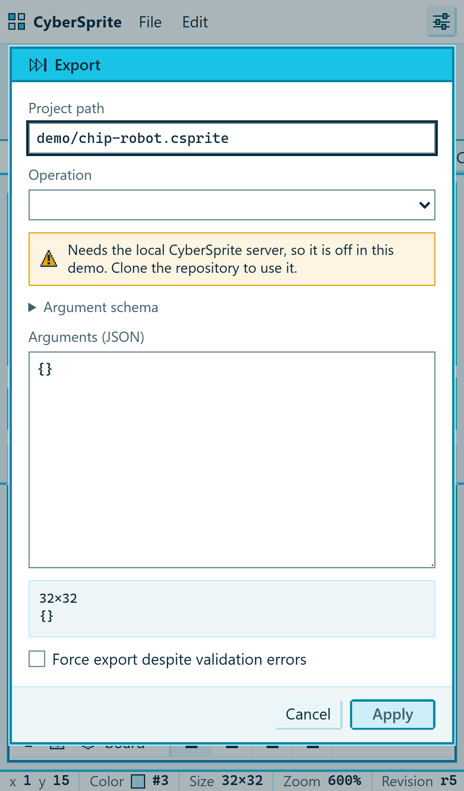

# GitHub Pages 体験デモ — 報告書

- ブランチ: `fixr1-demo`（worktree `CyberSprite-wt/demo`）。main への統合は統括側が行う。
- 担当: Claude Opus 5.5（デザインとビジュアル、GUI の操作感）
- 要件の正本: `_handoff/REVIEW_NOTES_FOR_FABLE.md` の項目 10 と追補（2026-11-12 14:25）

## 1. 何を作ったか

既存 GUI（`gui/`、Vite＋React）に、**ブラウザ内だけで動くデモモード**をビルドモードとして加えた。

| 部分 | 中身 |
|---|---|
| 差し替えの継ぎ目 | `gui/src/api/client.ts` に `Transport` 接口を足し、store がそれだけに依存する形にした。通常ビルドは従来どおり `RpcClient`（WebSocket）。デモは `DemoClient` |
| 疑似バックエンド | `gui/src/demo/backend.ts`。GUI が呼ぶ JSON-RPC（`project.get`、`op.apply`、`render.frame`、`history.undo/redo`、`validate.run` ほか）に、サーバと同じ名前と封筒で答える。ピクセルはパレット番号だけ。図形は GUI の暫定ラスタ規則（`src/raster`）を使った整数計算。取り消しはスナップショット。JSON を往復させて返すので、UI は通信越しと同じ形のデータを受け取る |
| サンプルデータ | `gui/src/demo/fixture.ts`。自作の 32×32、16 色、4 フレームの「Chip」（基板の上を歩く小さなロボット）。レイヤーは board（1 枚のセルを全フレームにリンク）、chip（歩行 4 コマ）、sparks（奇数フレームだけ。空セルの表示例）。タグは `walk`（順再生）と `hop`（ピンポン）。文字の格子で書いてあるので、差分で読める |
| デモの案内 | `gui/src/components/DemoNotice.tsx`。メニューの下に常に出る帯。「これはブラウザだけで動く体験デモです。本物はリポジトリをクローンして、AI エージェント連携（CLI / MCP）とローカル GUI で使います」。狭い幅では短い文に切り替わる。帯に「エージェントのコミットを再現」「サンプルを初期化」のボタンを置いた |
| レスポンシブ | `gui/src/theme/app.css` の末尾。1180px 以下では側面パネルを細くし、補助メニューを畳む。760px 以下では縦積み（後述） |
| ビルド | `npm run build:demo` → `gui/demo-dist/`（base `./`、git 管理外）。`dev:demo`、`preview:demo`、`check:demo` も追加 |
| 公開の仕掛け | `.github/workflows/pages.yml`。`workflow_dispatch` だけで動く（push では動かない） |

UI コンポーネントは分岐も複製もしていない。デモ専用の分岐は次の 3 か所だけで、どれも `DEMO` 定数（`import.meta.env.MODE === 'demo'`）で切り替わる。

1. `main.tsx`: 接続先の選択（`RpcClient` か `DemoClient` か）
2. `App.tsx`: `{DEMO && <DemoNotice />}`
3. `i18n/index.ts`: 2 つの共有文言の言い換え（「接続中」→「ブラウザ内デモ」、利用不可の注記 → 「ローカルサーバが必要」）

Vite が定数を畳み込むので、通常ビルド（`npm run build`）にはデモのコードが入らない。成果物に `E_DEMO_SERVER_ONLY` や `chip-robot` が含まれないことを grep で確認した。サーバとコア（`src/cybersprite/`）は変更していない。

### 通常ビルドにも及ぶ小さな変更

- `Icon` の画像パスを `/icons/…` から `${import.meta.env.BASE_URL}icons/…` に変えた。通常ビルドの BASE_URL は `/` なので結果は同じ。サブパスに置く Pages のために必要。
- `app-shell` の格子に `grid-template-areas` を付け、デモの帯用に高さ `auto` の行を足した。帯がなければ高さは 0 なので、通常の見た目は変わらない。
- レスポンシブの規則とパネル切替タブ（`.dock-switch`、狭い幅でだけ表示）は通常ビルドにも効く。ローカル GUI を狭いウィンドウで開いたときにも同じように畳まれる。

## 2. デモでできること／できないこと

**できること（ブラウザ内で実際に動く）**

- 描画: 鉛筆、消しゴム、直線、矩形、楕円（塗りあり・なし）、塗りつぶし（4／8 連結）、スポイト、矩形選択と移動、ブラシの大きさと形、ピクセルパーフェクト
- タッチ描画（`touch-action: none` のキャンバスに Pointer Events を使う。CDP のタッチ入力で確認済み）
- パレット: 前景色と背景色の選択、入れ替え（パレット自体はロックされたまま）
- レイヤーの表示・非表示とロック（ロック中に描くと `E_LAYER_LOCKED` とヒントを返す）
- リンクセルの編集（board に描くと全フレームが変わり、結果の `linked_frames` に出る）
- フレーム: 移動、再生と停止、タグ（順再生・ピンポン）による範囲再生、オニオンスキン、グリッド、フレーム時間の変更
- 拡大縮小（ボタン、ホイール、ズームツール）とパン（手のひらツール、Space＋ドラッグ）
- 取り消し、やり直し、活動一覧から任意のリビジョンへの復元
- 活動、検証（簡易版）、差分（2 リビジョン間の差分画像と変化の範囲）
- 「エージェントのコミットを再現」: 筋書きどおりのコミットを `agent:demo` として 3 種類順に適用する。本物のサーバと同じ `project.changed` 通知を使うので、W1 の演出（エージェントパネルの信号と、変わった範囲を 1 秒囲む紫の枠）がそのまま見える
- 設定（言語、コントラスト、文字の大きさ、表示倍率、動き）

**できないこと（ヒント付きで断る。黙って成功したふりはしない）**

- 新規作成、開く、閉じる、取り込み（変換パイプライン）、書き出し、来歴の画像。これらは `E_DEMO_SERVER_ONLY` を返し、「リポジトリをクローンして `cybersprite gui`、または AI エージェントから CLI / MCP で使ってください」というヒントを出す。ファイルメニューのダイアログでは、Op の一覧が空になり、「ローカルの CyberSprite サーバが必要なため、このデモでは使えません」と表示する
- 本物の validate（コアの検証規則）。デモの検証は簡易版で、常に info `DEMO_SIMULATED` を出してそのことを明示する
- 保存。ページを再読み込みすると、同梱のサンプルに戻る
- 2 本指のピンチズーム（拡大縮小はボタンで行う）

## 3. 見た目の判断（テーマ「Solder Mask」に寄せた分岐）

- **デモの帯**: 選択行と同じ淡い水色の面に、下辺を濃い水色の 1 本線にした。左端に反転色の面取りパッドを置き、シルク印刷の「DEMO」（英語表示では日本語名を隠す）を載せた。目立つが警告色ではない。注意を促すものではなく、案内だから。
- **スマホ（760px 以下）の構成**: 上から、メニュー（ファイル・編集・設定だけ）、デモの帯、ツール設定（横スクロール）、キャンバス、横倒しのツールチップ、パネル切替タブ、ドック（パレット／タイムライン／エージェントのどれか 1 枚）、状態バー（横スクロール）。キャンバスが常に見えて、手元のパネルを切り替える形にした。
- **ツールバー**: DIP の IC を横に倒した。ピンは上下に並べ、アイコンは等倍（16px）で幅に均等に詰めるので、横スクロールなしで 11 個が並ぶ。
- **ドック**: 切替タブがパネル名を示すので、ドック内のパネルの見出し帯は隠した（名前が二重に出るのを避ける）。タブは既存のエージェントタブと同じ形。
- **中間幅（1180px 以下）**: 側面パネルを細くし、エージェントタブはアイコンだけにした（文字は読み上げ用に残す）。
- **初期の拡大率**: スマホは 600%、高さ 860px 未満の PC は 800%、それ以上は 1000%。
- **サンプルの絵**: テーマの白・水色・基板の色で描いた。背景は基板の配線とビア、主役は水色の小さなロボット。

決めたことは `docs/DECISIONS.md` の I-DEMO-1〜3 に記録した。

## 4. Pages 公開の手順（発注者が行う操作）

前提として、リポジトリを GitHub に push してあること。2026-11-12 時点では GitHub のリポジトリはまだない。

1. GitHub のリポジトリで **Settings → Pages → Build and deployment → Source** を **GitHub Actions** にする（最初の 1 回だけ）。
2. **Actions → 「Pages demo」 → Run workflow**（ブランチは main）を押す。
3. 終わると、ジョブ `deploy` の画面に公開 URL（`https://<ユーザー名>.github.io/<リポジトリ名>/`）が出る。

ワークフローの中身: checkout → uv（アイコンを `.csprite` から CLI で書き出すため）→ Node 24 → `npm ci` → `npm test`（vitest とコントラスト検査）→ `npm run build:demo`（デモの帯にリポジトリへのリンクを入れるため `VITE_DEMO_REPO_URL` を渡す）→ `.nojekyll` → `upload-pages-artifact` → `deploy-pages`。トリガーは `workflow_dispatch` だけなので、push しても自動では公開されない。

手元で確かめるには次のとおり。

```powershell
cd gui
npm run build:demo
npm run preview:demo    # http://127.0.0.1:4174/ を開く
```

`file://` で `demo-dist/index.html` を直接開く方法は使えない。Chrome などは `file://` から ES モジュールのスクリプトを読み込まないため。簡易サーバ（上記の `preview:demo`、または `npx serve demo-dist` など）を使うこと。base は `./` なので、どのサブパスに置いても動く。

## 5. テスト結果（2026-11-12、Windows 11、ローカル）

| 検査 | 結果 |
|---|---|
| `npm test`（vitest） | 4 ファイル 636 件すべて合格。うち新規の `src/demo/backend.test.ts` は 9 件: サンプルの構造、決定性（同じ Op 列なら同じ RGBA）、描画と RGBA8、リンクセル、undo・redo・復元・redo 枝の破棄、ロールバックとエラーコード、サーバ専用操作の拒否、エージェント通知、差分 |
| `npm run check:contrast` | 通常版・高コントラスト版ともに 44/44 合格。デモの帯の組（`--ui-text` / `--ui-sel-bg`）を表に追加した |
| `tsc --noEmit` | エラーなし |
| `npm run build`（通常） | 成功。成果物にデモのコードが含まれないことを確認 |
| `npm run build:demo` | 成功（JS 260 KB＋疑似バックエンド 18 KB、gzip 後は約 91 KB） |
| `npm run test:e2e`（実サーバ） | 3/3 合格。1 回目は W2 のテストがキャンバスの表示待ちで失敗したが、再実行で合格した。合格した回でもこのテストは 27.9 秒かかり、制限の 30 秒に近い。サーバの初回起動の遅さによる不安定さと判断した。変更を退避した main の状態でも 3/3 合格を確認している |
| `npm run check:demo` | 44 項目すべて合格。PC（1440×900 日本語、1280×720 英語）とスマホ（Pixel 7 日本語、iPhone 13 相当の英語）の 4 環境で、以下を確認した。サブパス `/CyberSprite/` で開ける。帯が見える。横にはみ出さない。マウスまたはタッチの線で r4 になる。リンクセルへの塗りつぶしで r5 になる。エージェントのコミットの再現で r6 になり、活動一覧に出る。取り消しで r5 に戻る。再生でフレームが進む。書き出しに「サーバが必要」の注記が出る。コンソールエラーが 0 件 |
| `tools/check_repository.py` | OK |

Linux 上のワークフローの実走は未確認（GitHub がまだないため）。

## 6. スクリーンショット

`docs/design/demo/` に置いた（`npm run check:demo` の出力から選んだ）。

| PC 幅 | |
|---|---|
|  | 1440×900、日本語。開いた直後 |
|  | 1280×720、英語。中間幅で帯は短い文 |
|  | 線、塗りつぶし、エージェントのコミットの再現のあと |

| スマホ幅 | |
|---|---|
|  | Pixel 7、日本語。開いた直後（タイムラインのドック） |
|  | タッチで描いたあと、エージェントのドック |
|  | 再生中 |
|  | 書き出しはサーバが必要、という表示 |

## 7. 変更したファイル

- 新規: `gui/src/demo/{flag,fixture,backend,backend.test}.ts`、`gui/src/components/DemoNotice.tsx`、`gui/scripts/demo-check.mjs`、`.github/workflows/pages.yml`、`docs/DEMO_REPORT.md`、`docs/design/demo/*.png`
- 変更: `gui/src/{main,App}.tsx`、`gui/src/api/client.ts`、`gui/src/store/index.ts`（型だけ）、`gui/src/components/chrome.tsx`（アイコンのパス）、`gui/src/i18n/{index.ts,en.json,ja.json}`、`gui/src/theme/{app,tokens}.css`、`gui/scripts/check-contrast.mjs`、`gui/vite.config.ts`、`gui/package.json`、`.gitignore`、`docs/GUI.md`、`docs/DECISIONS.md`、`gui/README.md`
- 新しい依存はない。

## 8. 残り・申し送り

- 書き出しダイアログの「適用」ボタンは、無効でも `primary` の見た目のまま（通常ビルドにもある既存の挙動）。無効時の見た目を揃えるかどうかは、別件で判断してほしい。
- ピンチズームは未対応。
- e2e の W2 は、制限時間の 30 秒に近く不安定。`playwright.config.ts` の timeout の見直しを推奨する（今回の範囲外なので変更していない）。
