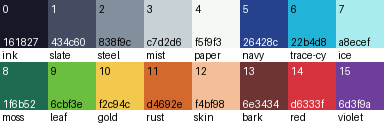
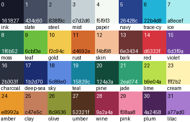

# 同梱パレットの設計メモ

同梱プリセットの正本は `src/cybersprite/data/palettes/*.gpl`、一覧は同じ場所の `index.json` である。
この文書は意図と使い方の説明であり、色の値が食い違ったら `.gpl` が正しい。

## 共通の約束

- プリセットのファイルには不透明色だけを入れる。`new_project` でプリセットを使うと、コアが先頭（番号 0）に透明色 `#00000000` を足す（`transparent_index` 0）。
- したがって **プロジェクトのパレット番号 = ファイル内の番号 + 1** である。下の表では両方を書く（「ファイル」「プロジェクト」）。
- `cs-circuit-16` と `cs-circuit-32` は CyberSprite の自作（Apache-2.0）。既存の公開パレットを写したり近似したりしていない。
- `bw-1bit`、`gray-4`、`gray-8` は機器・計算で決まる事実の色であり、CC0-1.0 とする。

| プリセット | 色数 | プロジェクトでの色数 | ライセンス | 由来 |
|---|---|---|---|---|
| `cs-circuit-16` | 16 | 17 | Apache-2.0 | 自作（既定） |
| `cs-circuit-32` | 32 | 33 | Apache-2.0 | 自作（16 の上位集合） |
| `bw-1bit` | 2 | 3 | CC0-1.0 | 機器 |
| `gray-4` | 4 | 5 | CC0-1.0 | 機器 |
| `gray-8` | 8 | 9 | CC0-1.0 | 機器 |

## cs-circuit-16（既定）

### 意図

- ゲーム用スプライト（キャラクター、タイル、UI）を 16 色で一通り描けること。輪郭、肌、草、石、水、金属、宝物、炎、魔法を想定した。
- ブランドの「白と水色の回路基板」に合わせ、白（`paper`）と水色（`trace-cyan`）を柱にした。`paper` はわずかに緑みの白、`ink` は青紫に寄せた黒で、純黒・純白は使わない。
- 1 色が複数の段階を兼ねるように、色相をずらしながら明るくする（影は青紫へ、光は黄へ）。例: `moss → leaf → gold` は緑の段階、`bark → red → rust → gold` は炎の段階。
- 1 倍表示で読めることを確認した（`ink` と `navy`、`ink` と `slate` は並べても区別できる）。

### 色と役割

| ファイル | プロジェクト | 名前 | 16 進 | 役割 |
|---|---|---|---|---|
| 0 | 1 | `ink` | `#161827` | 輪郭、最暗部。純黒の代わり |
| 1 | 2 | `slate` | `#434c60` | 青みの暗い灰。石や金属の影、暗い服、夜の背景 |
| 2 | 3 | `steel` | `#838f9c` | 中間の灰。石、金属、道 |
| 3 | 4 | `mist` | `#c7d2d6` | 明るい灰。金属の光、雲、UI の面 |
| 4 | 5 | `paper` | `#f5f9f3` | ほぼ白。最明部、ハイライト、文字 |
| 5 | 6 | `navy` | `#26428c` | 濃い青。水や布の影、夜空、髪 |
| 6 | 7 | `trace-cyan` | `#22b4d8` | 主役の水色。水、ガラス、電気、ブランド色 |
| 7 | 8 | `ice` | `#a8ecef` | 明るい水色。水色系の光、氷、空 |
| 8 | 9 | `moss` | `#1f6b52` | 青みの濃い緑。草や葉の影、回路基板の緑 |
| 9 | 10 | `leaf` | `#6cbf3e` | 明るい緑。草、葉 |
| 10 | 11 | `gold` | `#f2c94c` | 黄・金。金貨、光、緑や炎の最明部 |
| 11 | 12 | `rust` | `#d4692e` | 橙。肌の影、木、炎、錆 |
| 12 | 13 | `skin` | `#f4bf98` | 明るい肌。砂、パン、木の明部 |
| 13 | 14 | `bark` | `#6e3434` | 赤茶。木の幹、髪、靴、赤と肌の最暗部 |
| 14 | 15 | `red` | `#d6333f` | 赤。体力、危険、果物、炎 |
| 15 | 16 | `violet` | `#6d3f9a` | 紫。魔法、毒、影の色味づけ |

### 推奨ランプ

数字はファイル内の番号、括弧内がプロジェクトの番号。

| ランプ | ファイル番号 | プロジェクト番号 |
|---|---|---|
| 灰（石・金属） | 0 → 1 → 2 → 3 → 4 | 1 → 2 → 3 → 4 → 5 |
| 水色（水・ガラス） | 0 → 5 → 6 → 7 → 4 | 1 → 6 → 7 → 8 → 5 |
| 緑（草・葉） | 0 → 8 → 9 → 10 → 4 | 1 → 9 → 10 → 11 → 5 |
| 肌 | 13 → 11 → 12 → 4 | 14 → 12 → 13 → 5 |
| 赤・炎 | 0 → 13 → 14 → 11 → 10 | 1 → 14 → 15 → 12 → 11 |
| 紫（魔法） | 0 → 15 → 14 → 11 → 10 | 1 → 16 → 15 → 12 → 11 |
| 冷たい魔法 | 0 → 5 → 15 → 6 → 7 | 1 → 6 → 16 → 7 → 8 |

## cs-circuit-32

ファイルの 0〜15 は `cs-circuit-16` と同一（同じ番号、同じ値）。16 色で描いた絵は、32 色に切り替えても番号を付け替えずにそのまま使える。16〜31 は各ランプの間を埋める色である。

| ファイル | プロジェクト | 名前 | 16 進 | 役割 |
|---|---|---|---|---|
| 16 | 17 | `charcoal` | `#2b303f` | `ink` と `slate` の間の暗い灰 |
| 17 | 18 | `deep-sea` | `#1b2d70` | 最も濃い青。深い水、夜空 |
| 18 | 19 | `sky` | `#5c88e0` | 中間の青。空、青い布 |
| 19 | 20 | `teal` | `#15829c` | 濃い水色。水色の影 |
| 20 | 21 | `pine` | `#124a3a` | 最も濃い緑。森の影 |
| 21 | 22 | `jade` | `#2ea074` | 青緑の中間。葉、宝石 |
| 22 | 23 | `lime` | `#b9e04a` | 黄緑。草の光 |
| 23 | 24 | `cream` | `#fff2b2` | 淡い黄。暖色系の最明部、光源 |
| 24 | 25 | `amber` | `#e8992a` | 琥珀。金の影、炎の中間 |
| 25 | 26 | `clay` | `#c47e5c` | 肌の中間影、土、レンガ |
| 26 | 27 | `olive` | `#8c9636` | 枯れ草、苔、軍服 |
| 27 | 28 | `umber` | `#52321f` | 濃い茶。土、木の最暗部 |
| 28 | 29 | `wine` | `#9a2a4a` | 赤紫の影。赤の暗部 |
| 29 | 30 | `pink` | `#f08aa8` | 桃色。頬、花、赤の明部 |
| 30 | 31 | `plum` | `#4a2458` | 濃い紫。紫の最暗部 |
| 31 | 32 | `lilac` | `#a77ad0` | 明るい紫。紫の明部 |

| ランプ | ファイル番号 | プロジェクト番号 |
|---|---|---|
| 灰 | 0 → 16 → 1 → 2 → 3 → 4 | 1 → 17 → 2 → 3 → 4 → 5 |
| 青 | 0 → 17 → 5 → 18 → 7 → 4 | 1 → 18 → 6 → 19 → 8 → 5 |
| 水色 | 17 → 19 → 6 → 7 → 4 | 18 → 20 → 7 → 8 → 5 |
| 緑 | 0 → 20 → 8 → 21 → 9 → 22 → 23 | 1 → 21 → 9 → 22 → 10 → 23 → 24 |
| 肌 | 27 → 13 → 25 → 12 → 4 | 28 → 14 → 26 → 13 → 5 |
| 金・炎 | 27 → 11 → 24 → 10 → 23 | 28 → 12 → 25 → 11 → 24 |
| 枯れ草 | 20 → 8 → 26 → 22 → 23 | 21 → 9 → 27 → 23 → 24 |
| 赤 | 30 → 28 → 14 → 29 → 4 | 31 → 29 → 15 → 30 → 5 |
| 紫 | 0 → 30 → 15 → 31 → 7 | 1 → 31 → 16 → 32 → 8 |

## 機器パレット

いずれも灰色は R = G = B で、値は整数の床除算で決める（浮動小数を使わない）。

- `bw-1bit`: `#000000`（black）、`#ffffff`（white）。
- `gray-4`: `value(i) = i * 255 // 3`（i = 0..3）。結果は 0, 85, 170, 255。
- `gray-8`: `value(i) = i * 255 // 7`（i = 0..7）。結果は 0, 36, 72, 109, 145, 182, 218, 255。

色名は `gray-<i>`（i はファイル内の番号）とした。

## 確かめたこと

- 16 色だけで 16×16 のキャラクター、草タイル、石タイル、小物（薬瓶、金貨、ハート、宝石）を描き、8 倍・2 倍・1 倍で `paper`、`mist`、`slate` の 3 種類の下地に置いて見た。タイルは 3×3 に並べて継ぎ目を見た。
- 隣り合うランプの段階が区別できること、`ink` と `navy`・`slate`・`bark` が区別できることを目で確かめた。
- 32 色では、RGB 距離の近い組（例: `charcoal` と `plum`、`skin` と砂色の候補）を数値で洗い出し、色相か明度を離すか、別の色に差し替えた。
