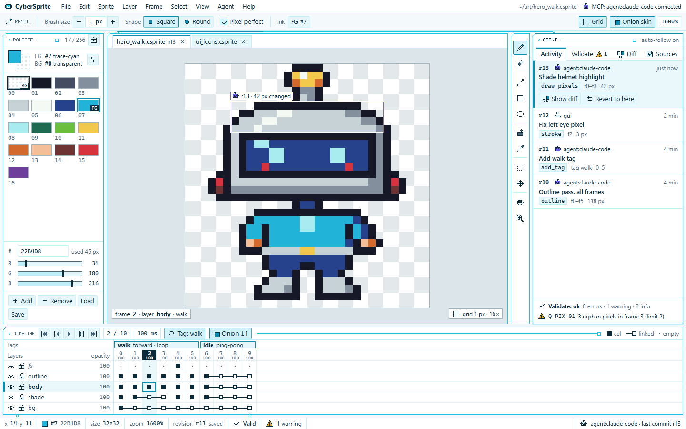
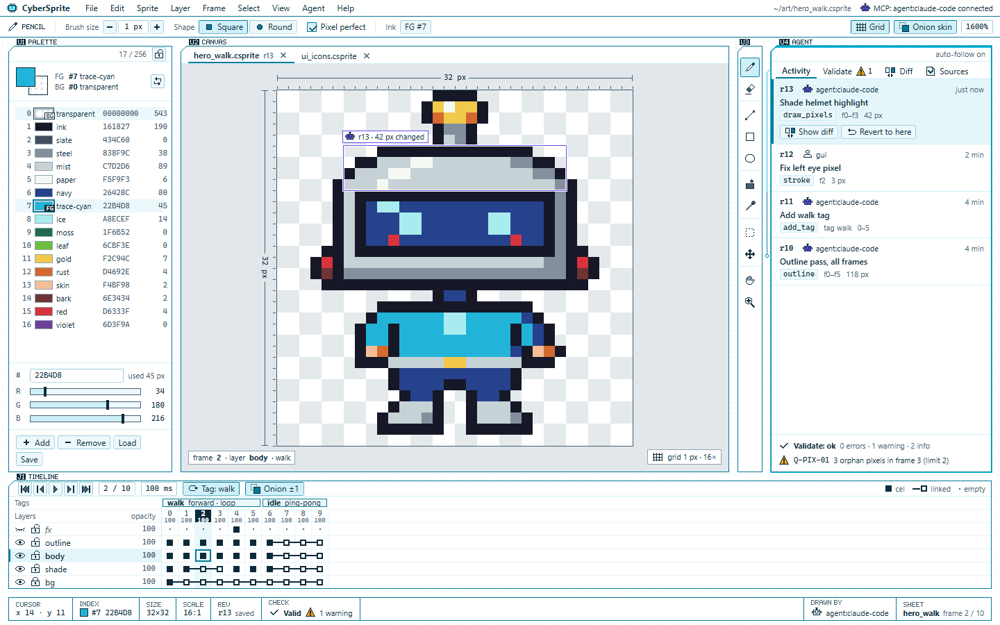
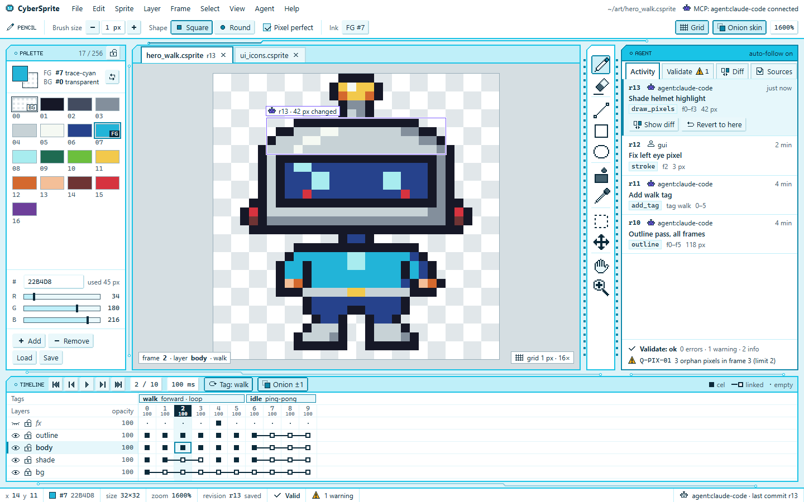

# テーマ「Circuit White」— 方向性の異なる 3 案

SPEC §14.3.4 手順 1 の成果物。メイン画面（§14.2）の静的モックアップを、§14.3.1〜§14.3.3 の範囲で方向性を変えて 3 つ作った。
選定（手順 2）はオーケストレーターが行う。この文書の最後に、デザイン担当（Opus）としての推薦を書く。

| 案 | 画面 | ソース |
|---|---|---|
| A — Silk（静かな白い基板） |  | `option-a/index.html` + `style.css` |
| B — Schematic（製図・回路図） |  | `option-b/index.html` + `style.css` |
| C — Solder Mask（水色のソルダーマスク） |  | `option-c/index.html` + `style.css` |

## 見方と再生成

- 各 `index.html` は単独で開ける（ネットワーク、CDN、外部フォント、外部画像なし）。画面は 1440×900 に固定。
- `tools/build_mockups.py` が 3 案の HTML と CSS を生成する。`tools/pixels.py` に、自作のピクセル素材（5×7 のシルク印刷フォント、16×16 アイコン 40 種、作例スプライト 32×32、配線とビアのラスタライズ、IC の切り欠き）がある。
- `tools/render.sh` がヘッドレス Chrome で `option-?.png` を撮る（1440×900、等倍）。
- `tools/contrast_check.py` が `style.css` の CSS 変数を読んでコントラスト比を検査し、`CONTRAST.md` を書く（不合格があれば終了コード 1）。

```
python docs/design/theme-options/tools/build_mockups.py
sh     docs/design/theme-options/tools/render.sh
python docs/design/theme-options/tools/contrast_check.py
```

## 3 案に共通すること

- 構成は §14.2 のとおり: メニューバー（File Edit Sprite Layer Frame Select View Agent Help）、コンテキストバー、パレット（番号つき 17 色、FG / BG、16 進入力と RGB、使用ピクセル数）、ドキュメントタブ、キャンバス（16 倍、彩度の低い周囲、市松模様、最新コミット r13 の変更範囲を重ねて表示）、ツールバー（11 種）、エージェントパネル（Activity / Validate / Diff / Sources、`agent:claude-code` と `gui` の行）、タイムライン（表示・ロック付きのレイヤーの木、セルの 3 状態、タグの帯 `walk` と `idle`）、ステータスバー（座標、パレット番号と色、大きさ、拡大率、r13、検証状態）。
- トークンはすべて CSS 変数。各 `style.css` の先頭の `:root` が §14.3.1 のトークン、2 つ目の `:root` がそこから派生した部品用の変数である。差し替えは `:root` の書き換えで済む。
- ピクセルの鮮明さ: アイコン、フォント、スプライト、ビア、切り欠き、配線は 1 px の矩形だけで描いた SVG（`shape-rendering: crispEdges`）。ぼかし・グラデーションの発光・角丸・アンチエイリアスの曲線は使っていない。「発光」は `box-shadow: 0 0 0 1px`（1 px 外側の線）。斜めの線は 45° の階段だけ。市松模様とドットの格子は整数位置の硬い色境界だけで作った。
- パッドの面取りは `clip-path` の階段（A・B は 1 段、C は 2 段）。パネルの切り欠きは左上の 45° で、境界線・外側・1 px の通電線を画素単位で描いたオーバーレイ。
- 文字は必ず `--cs-ink` / `--cs-ink-soft`（反転時は白）。水色は文字に使っていない。状態は色だけで示さない（下の表）。
- 通電の信号（エージェントのコミット時、キャンバス側から Activity タブへ配線を 3 コマで走る、300 ms）を CSS の `steps` アニメーションで入れた。`prefers-reduced-motion: reduce` で止まる。静止画には写らない。

| 状態 | 形・文字での示し方 |
|---|---|
| 選択中のツール | 濃い水色の枠＋面の色＋アイコンの塗りが濃くなる |
| 選択中の行 / レイヤー | 左端の帯（3 px）＋面の色＋太字 |
| セル | 空 = 2 px の点、あり = 塗りの四角、リンク = 白抜きの四角＋前のセルへの連結線 |
| 現在のフレーム | 見出しの反転（濃紺に白）＋列の面の色、選択セルは 2 px の枠 |
| 実行者 | ロボットのアイコン＋`agent:…` / 人のアイコン＋`gui` |
| 検証 | チェックの記号＋「Valid」、三角の記号＋件数と規則 ID |
| 表示・ロック | 開いた目 / 閉じた目（斜体の名前）、閉じた錠 / 開いた錠 |
| FG / BG | 枠の太さの違い＋`FG` / `BG` の札 |

## 案 A — Silk（静かな白い基板）

**コンセプト**: §14.3.1 の初期値をそのまま使い、もっとも静かに組んだ基準案。白い基板（`#F4FAFC`）に白いパネルを 6 px の間隔で並べ、パネルの枠は 1 px の明るい水色の配線。パネルの見出しは「名前のついたネット」で、ビア → シルク文字 → 右へ伸びる 1 px の配線 → 四角いビア、と読む。タブは箱型で、選択中は上に 2 px の濃い水色。装飾の配線は、コンテキストバーの下の隙間に 1 本（キャンバス → Activity タブの信号線）と、タイムラインの下に 1 本だけ。

| トークン | 値 | トークン | 値 |
|---|---|---|---|
| `--cs-board` | `#F4FAFC` | `--cs-ink` | `#0B2A3A` |
| `--cs-panel` | `#FFFFFF` | `--cs-ink-soft` | `#4A6878` |
| `--cs-pad` | `#E6F7FB` | `--cs-warn` | `#E8A317` |
| `--cs-trace` | `#19C3E6` | `--cs-error` | `#E5484D` |
| `--cs-trace-soft` | `#BFEFF9` | `--cs-agent` | `#7C5CFF` |
| `--cs-trace-deep` | `#0A8FB3` | `--cs-canvas-surround` | `#DCE6EA` |
| `--cs-checker-a` / `-b` | `#FFFFFF` / `#E3E8EB` | 派生: `--pad-on-bg` | `#D2F1F8` |

密度: 本文 13 px、行 22 px、タイムラインのセル幅 30 px、パネル境界 1 px、切り欠き 7 px。

- **強み**: 画面の大部分が白と無彩色で、水色は細い線だけ。長時間の作業でもっとも目が疲れにくい。初期トークンのままなので仕様との差がない。実装も最小。
- **リスク**: 明るい水色の 1 px 線は白地で約 2:1 しかなく、低品質の画面や 1 倍表示では枠が消えかけ、「基板らしさ」が弱い（ただの水色の線の UI に見えうる）。3 案の中で個性がもっとも薄い。

## 案 B — Schematic（製図・回路図）

**コンセプト**: 基板そのものではなく、基板の**製図**として組んだ案。下地は純白に 8 px 間隔の水色のドット格子（製図用紙）。パネルは部品で、枠は濃い水色（銅）の 1 px。パネル名は部品の外側、基板の上にシルク印刷される: 反転した参照記号の札（`U1` パレット、`U2` キャンバス、`U3` ツール、`U4` エージェント、`J1` タイムライン）＋ピクセルフォントの名前。キャンバスの上と左に寸法線（`32 px`）と 1 px ごとの目盛り。ステータスバーは図面の**表題欄**（CURSOR / INDEX / SIZE / SCALE 16:1 / REV r13 / CHECK / DRAWN BY / SHEET）。タブは下線型。明るい水色は「通電」（アクティブなパネルの 1 px 外側の線、ツールバー脇の信号線）にだけ使う。

| トークン | 値 | トークン | 値 |
|---|---|---|---|
| `--cs-board` | `#FFFFFF` | `--cs-ink` | `#0B2A3A` |
| `--cs-panel` | `#FFFFFF` | `--cs-ink-soft` | `#45606F` |
| `--cs-pad` | `#EDF8FB` | `--cs-warn` | `#E8A317` |
| `--cs-trace` | `#19C3E6` | `--cs-error` | `#D9434A` |
| `--cs-trace-soft` | `#CDEFF7` | `--cs-agent` | `#6B4CF0` |
| `--cs-trace-deep` | `#077A99` | `--cs-canvas-surround` | `#E1E7EA` |
| `--cs-checker-a` / `-b` | `#FFFFFF` / `#E4E9EC` | 追加: `--cs-grid` | `#B3E2EE`（ドット格子） |

密度: 本文 12 px（補助 11 px）、行 19 px、セル幅 24 px、パネル境界 1 px（銅色）、切り欠き 9 px、間隔 12 px（シルクを載せるため）。パレットは一覧形式（番号・色・名前・16 進・使用ピクセル数）。

- **強み**: 構造を描く線がすべて `--cs-trace-deep`（白地 4.9:1）なので、どの画面でも枠が消えない。基板らしさを色の面積ではなく**形と記号**（参照記号、ドット格子、寸法線、表題欄）で出しているため、「白基調」を文字どおり守りながら回路の世界観が強い。表題欄と一覧形式のパレットは、エージェントの作業を確かめる用途（リビジョン、検証、番号）と相性がよい。
- **リスク**: 情報密度が高く、文字が小さい（11〜12 px）。純白の面積が大きく、明るい部屋ではまぶしく感じる人がいる（`--cs-board` を `#F7FBFC` 程度に下げれば緩和できる）。「サイバーパンク」の派手さは 3 案でもっとも控えめ。

## 案 C — Solder Mask（水色のソルダーマスク）

**コンセプト**: 基板を**真上から見た**案。下地は淡い水色のソルダーマスク（`#DDF3F8`）で、パネルの隙間（10 px）を 2 px の配線が走り、45° で車線を乗り換え、端にビアがある。パネルは白い IC で、枠は 2 px、見出しは「チップの刻印」として水色で塗った帯。アクティブな（通電した）パネルは見出しが明るい水色のベタになり、濃紺の文字が載る。ツールバーは DIP の IC で、両脇にピンが並ぶ。ツールのアイコンは 2 倍（32 px）で、ピクセルアートであることを前面に出す。パッドは 2 段の面取りと、右下 2 px の影の色でキーのように見せる（単色のみ）。タブは厚みのあるパッド型。

| トークン | 値 | トークン | 値 |
|---|---|---|---|
| `--cs-board` | `#DDF3F8` | `--cs-ink` | `#0B2A3A` |
| `--cs-panel` | `#FFFFFF` | `--cs-ink-soft` | `#43606E` |
| `--cs-pad` | `#EAF8FB` | `--cs-warn` | `#E8A317` |
| `--cs-trace` | `#19C3E6` | `--cs-error` | `#E5484D` |
| `--cs-trace-soft` | `#BFEFF9` | `--cs-agent` | `#7C5CFF` |
| `--cs-trace-deep` | `#0A86A8` | `--cs-canvas-surround` | `#D5DEE2` |
| `--cs-checker-a` / `-b` | `#FFFFFF` / `#E1E7EA` | 追加: `--cs-mask-trace` | `#93D2E3`（マスク上の配線） |
| | | 追加: `--cs-pad-shade` | `#B9DDE6`（パッドの影） |

密度: 本文 13 px、行 22 px、セル幅 32 px、パネル境界 2 px、切り欠き 10 px、ツールボタン 34 px（アイコン 2 倍）。

- **強み**: 「白と水色の基板、ピクセルアート × サイバーパンク」という発注の言葉に、見た瞬間にもっとも近い。2 px の線と 2 倍のアイコンは、どの表示倍率でもピクセルが潰れず、ドット絵の道具であることがはっきり伝わる。通電した見出し（水色のベタに濃紺 7.1:1）が強い目印になる。
- **リスク**: 水色の面積が 3 案でいちばん大きい（下地全体と見出しの帯）。長時間の作業で周辺視野がずっと色を受け、疲れやすい。キャンバスの周囲は無彩色に保ってあるが、絵の色を判断するときに周辺の水色が干渉する可能性は残る。装飾（配線、ピン、ビア）が多く、画面が「にぎやか」に見える。通電した見出しの文字のコントラストは 7.10 で、基準 7.0 ぎりぎり。

## 3 案の比較

| 観点 | A — Silk | B — Schematic | C — Solder Mask |
|---|---|---|---|
| 下地 | ごく淡い水色がかった白 | 純白＋ドット格子 | 淡い水色のマスク |
| 枠の線 | 1 px、明るい水色 | 1 px、濃い水色（銅） | 2 px、明るい水色（通電で濃い水色） |
| シルク印刷 | パネル内の見出し＋ネット線 | パネル外の基板上、参照記号つき | 塗った見出し帯の刻印 |
| 切り欠き | 7 px | 9 px | 10 px |
| パッド | 1 段の面取り、淡い枠 | 1 段の面取り、やや濃い枠 | 2 段の面取り、右下に影 |
| 配線の意匠 | 最小限（2 本） | 信号線 1 本＋寸法線 | 隙間を走るバス、45° の乗り換え、ピン |
| 密度 | 標準 | 高い | 低い（大きめ） |
| 水色の面積 | 小 | 最小 | 大 |

## 推薦（デザイン担当の意見。最終の選定はオーケストレーター）

**推薦: 案 B — Schematic。** 案 C のツールアイコン 2 倍表示を設定で選べるようにする前提で推す。

1. **白と水色の基板らしさ**: C が最も直接的で、B が次点、A は弱い。ただし B は基板らしさを、参照記号・ドット格子・寸法線・表題欄という**形**で出している。水色の面を広げずに世界観を作れるので、「暗い基板ではなく白基調」という指定を守ったまま基板の印象を得られる。
2. **ピクセルの鮮明さ**: 3 案とも、1 px 格子とアンチエイリアスなしの約束は守っている。違いが出るのは線が「見えるかどうか」である。A の枠は白地で約 2:1 の明るい水色なので、表示環境によっては消えかける。B は構造の線がすべて 3:1 以上の銅色で、1 倍でもはっきり見える。C は 2 px の線で同じく強い。
3. **長時間使って疲れないこと**: A が最良で、B がほぼ同等、C は不利。B では、明るい水色は「通電」の瞬間と細い線にしか出てこない。キャンバスの周囲も無彩色に近い（クロマ 0.04）。色の判断を邪魔するものがもっとも少ない。

B を採るときの手当て: (a) 本文を 12 px から 13 px に上げる設定を用意する。(b) まぶしさが気になる場合は、`--cs-board` を `#F7FBFC` に下げる。(c) C の 2 倍アイコンと DIP ピンのツールバーは、B に移植しても破綻しない。B の弱点である「楽しさ」を補う候補になる。

もし「発注者の第一印象」を最も重く見るなら、C を選び、`--cs-board` をもっと白に寄せ（例: `#EEF9FB`）、通電していない見出しの帯を白にして水色の面積を減らす、という調整が考えられる。

## 未実装・申し送り

- アイコンの原本は、§14.3.2 では `assets/ui/icons/*.csprite` に置く決まりである。ここでは、モックアップ用に `tools/pixels.py` の文字列グリッドで持っている。採用が決まったら、同じグリッドから `.csprite` を作る（M8）。
- 高コントラスト版（§14.3.3。線を `--cs-ink`、面を白）は描いていない。どの案も、トークンの差し替えだけで作れる構造にしてある。
- 日本語 UI の文字組（行の高さ、ピクセルフォントは英大文字のみ）は未検証。見出しのシルク文字は英字の識別子として残し、日本語の名前は本文フォントで併記する想定である。
- 作例スプライトは同梱パレット `cs-circuit-16` の色（プロジェクト番号 0〜16）で自作した。

## クリーンルーム

他製品のアイコン、スキン、配色表、スクリーンショット、文言は、見ても使ってもいない。アイコン 40 種、フォント、スプライト、切り欠き、ビアは、すべて `tools/pixels.py` でこのために描いた。外部の依存は Python 標準ライブラリだけである（PNG の撮影には、ローカルの Chrome を道具として使った）。
